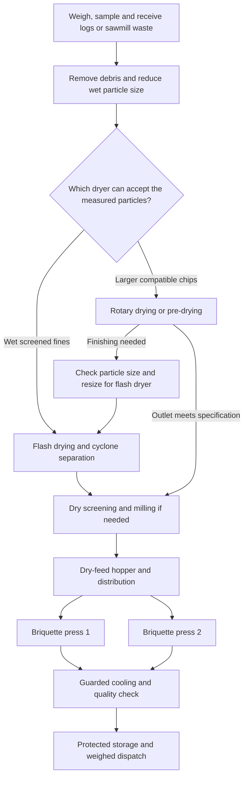

# Factory inspection photo evidence — AKASHYA ENTERPRISES
**Audit: 22 Nov 2026.** The nine photographs were taken at the same reference briquette factory. These are **field observations**, not a manufacturer performance certificate or a measurement survey.

| Reference photo & hardware | Directly visible in photograph | Functional purpose in Akashya 1,000 MT/month plant | Engineering duty check & verification gap |
|---|---|---|---|
| [01: dryer/cyclone/MCC](../FACTORY-PHOTOS/01-drying-tower-cyclone-mcc-panel.jpg) | Tall vertical vessels, duct columns, and industrial electrical control cabinets | Hot furnace gas drying, cyclonic dust separation, and centralized power distribution | Verify water evaporation rating ($\ge 1,563\text{ kg/h}$ at 40%, $\ge 2,492\text{ kg/h}$ at 50%); stack emission clearance; MCC motor starter ratings |
| [02: factory interior & heap](../FACTORY-PHOTOS/02-factory-interior-briquette-heap.jpg) | Covered shed, cylindrical product heap and two apparent reddish press structures | Proposed Akashya design uses two parallel mechanical presses | Count active machines and record actual per-press saleable kg/h. Proposed 1.471 TPH per press is target arithmetic. |
| [03: EcoStan chipper](../FACTORY-PHOTOS/03-ecostan-wood-chipper-close.jpg) | Yellow EcoStan-branded machine with yellow-and-black feeding conveyor receiving logs | Primary log-to-sawdust size reduction: converts incoming logs/branches into small particles | Nameplate model unverified (ESM150 vs others); seek demonstrated **≥6 wet TPH** on local hardwood for either route |
| [04: raw wood yard](../FACTORY-PHOTOS/04-raw-wood-logs-yard-chipper.jpg) | Mixed logs and branches stacked near the infeed | Reference for receiving and traceable stock control | Identify species, moisture, lot weight and procurement source. Project intake is 63.2 wet MT/day at 40%, or 75.8 at 50%. |
| [05: mechanical press & flywheel](../FACTORY-PHOTOS/05-mechanical-piston-press-flywheel.jpg) | Heavy press drive, visible flywheel and feed hopper | The flywheel stores rotational energy through the piston’s cyclic load. Confirm the actual drive layout and guarding. | Identify OEM, model and drive. Measure loaded stroke count. Use the exact maker’s approved bearing and lubricant limits. Photo alone supplies no instrument readings. |
| [06: sawdust discharge conveyor](../FACTORY-PHOTOS/06-inclined-conveyor-sawdust-discharge.jpg) | Inclined conveyor transporting processed wood particles | Continuous material transfer from primary chipper to dryer and intermediate storage | Confirm whether the observed conveyor carries wet or dried material. For Akashya, size the wet transfer for **≥6 wet TPH** and dry transfer for **~3.08 fresh TPH plus reserve and rework**. |
| [07: tractor loader](../FACTORY-PHOTOS/07-tractor-loader-sawdust-handling.jpg) | Tractor loader moving bulk sawdust piles with visible airborne dust | Inbound wood unloading, stockpile management, and log yard material manipulation | Open loader handling creates combustible-dust explosion hazards; Akashya plant must incorporate enclosed chutes and dust extraction |
| [08: pneumatic flash U-ducts](../FACTORY-PHOTOS/08-pneumatic-flash-dryer-u-tubes.jpg) | Tall U-shaped ducts and connected separation equipment | Visual reference for pneumatic drying or air handling | Confirm flow path, heat source and product takeoff by survey. Project dryer duty requires separate wet-inlet, evaporation and dried-output data. |
| [09: finished briquettes & cooling](../FACTORY-PHOTOS/09-90mm-finished-briquettes-cooling-track.jpg) | Brown cylindrical briquettes on a track, with some visible surface cracking | Cooling and transfer before protected storage | Measure actual diameter, cooled temperature, fines, moisture, ash and GCV. Apply buyer-approved test limits. |

---

## Manufacturing process flow

The proposed Akashya line shares receiving and discharge stages. The middle of the line depends on tested wood size and moisture.

The receiving conveyor and EcoStan-branded machine appear in photo 03, an inclined sawdust transfer appears in 06, and the ducts and cyclones appear in 01 and 08. The precise path and flow rates at the reference site need a walkthrough. For proposed design, screen untreated sawmill waste separately and route it to chipping, the wet dryer feed or dry grading according to measured particle size, moisture and contamination.

## Equipment capacity & purpose specification matrix

The duties are for Akashya’s proposed **1,000 saleable MT/month at 340 productive hours**. The photos above identify the reference hardware. Detailed dimensions, costs, service intervals and repairs are in the linked equipment schedules.

| Process equipment | Required input → output | Where to find the equipment detail |
|---|---|---|
| **Loader, weighbridge and log receiving** | Log, branch and sawmill-waste lots → weighed and sampled feed. **63.2 / 75.8 wet MT/day** at **40% / 50% moisture**. Size the proposed **50–60 MT** bridge for actual trucks. | BOM packages **09, 10, 03** |
| **Log feeder, chipper and inclined transfer** | Metered logs → sized wet particles, **≥6 wet TPH** design target. Match output to the dryer inlet. Infinite **IFD <8 mm**, **RFD <16 mm**. | BOM packages **03, 01** |
| **Dryer, furnace, fan, cyclone and airlock** | **4.64 / 5.57 wet TPH** → **~3.08 TPH dried material** and **1,563 / 2,492 kg/h water evaporation**. Match outlet moisture to downstream equipment. | BOM package **04**, [dryer and moisture design](05-WOOD-MOISTURE-AND-DRYER-SIZING.md) |
| **Dry screen, optional hammer mill and feed distribution** | **~3.08 fresh TPH** → graded, metered press feed. Size mill for actual oversize plus recycle, or the whole stream if required. | BOM packages **02, 03** |
| **Two presses, flywheel and cooling** | Typically **8–12% press-feed moisture** within OEM limits → saleable 90 mm product. RFQ target **1.60 TPH each**. Match each cooling outlet to the offered press. | BOM packages **05, 06**, [press models and rated outputs](04-BPM-Operating-Hours-and-Live-Machinery-Pricing.md) |
| **Dust and fire protection, electrical cabinets and utilities** | Engineered extraction and controlled exhaust; matched motor starts, interlocks, cabinet controls and HT/LT supply. | BOM packages **07, 08, 15** |

[Itemised BOM](../PROCUREMENT/COMPLETE-1000MT-TURNKEY-BILL-OF-MATERIALS.md) · [Service and repairs by machine](03-Breakdown-Risk-Mitigation-and-Maintenance-SOP.md#operating-controls--equipment-specific-estimated-checkrestservice-windows) · [Component price evidence](../PROCUREMENT/2026-11-22-LIVE-MACHINERY-PRICE-EVIDENCE.md#c-whole-line-ancillary-machinery--exact-technical-scope-indicative-prices-and-bottlenecks).

### Machine-by-machine use and interface engineering

The [expanded machine master](../PROCUREMENT/MACHINERY-MASTER.csv) records model-specific published values separately from generic engineering use, component wear and validation gaps. **98 records, 32 columns**; 13 additional catalogue entries. Catalogue figures are not guaranteed. For the process stages below, use actual wet/dry material density and measured distribution, not nominal capacity alone.

| Machine | Working purpose and location | Input → output / selection test | Critical wear or failure points |
|---|---|---|---|
| Weighbridge, log yard loader | Inbound weight, stock and controlled feeding | Weigh wet lot; sample moisture/species; loader payload and reach must suit truck and hopper | Load cells, hydraulics, pins, tyres; inspection and calibration |
| Receiving deck, feeder and magnet | Meter raw logs, reject foreign objects | Log size and bulk flow to cutting chamber; upstream ferrous removal plus stone control | Belt/chain, rolls, drive, hopper bridging; guard and isolate |
| Log eater / sawdust maker | Direct knife cutting of logs | Wet logs → sawdust; e.g. ESM100 quote 4–8 mm vs catalogue 2–10 mm; measure gradation and knife duty | Knife, anvil, feed rollers, rotor bearings |
| Drum chipper / shredder | Alternate primary or coarse reduction | Chips or shreds may need further reduction; select by measured dryer cut, not name | Knives/cutters, anvil, shaft, gearbox; tramp metal damage |
| Rotary or vibrating screen | Separate fines/oversize | Screen cut selected to dryer/press limits; wet-rated before dryer, dry-rated after; recycle oversize | Mesh blinding, bearings, imbalance |
| Wet buffer/box feeder | Smooth upstream flow and dryer dosing | Usable buffer volume = mass / measured bulk density; avoid wet stock degradation and bridging | Agitator, screw, level sensor; no assumed safe storage time |
| Flash dryer | Fast pneumatic hot-gas drying of fine feed | Fine particles → lower moisture; simultaneous wet feed, evaporation and dry output must balance | Fan, duct erosion, cyclone, airlock, heat controls |
| Rotary dryer / hybrid RFD | Pre-dry coarser/wetter compatible material; RFD adds flash finishing | Match moisture band and size; downstream press feed may need further sizing | Drive, supports, seals, lifters, fan, refractory |
| Furnace/fuel feed | Provide thermal energy, not mechanical HP | Fuel moisture and CV, fuel mass and heat efficiency; separate product and fuel flows | Refractory, ash, feeding; combustion/fire protection |
| Cyclone/airlock/ID fan | Gas-solid separation and pressure-controlled discharge | Cyclone collection and airlock capacity; fan airflow and static pressure, not only TPH | Impeller, seals, bearings, erosion; cyclone alone not final dust protection |
| Hammer mill | Screen-controlled reduction of pre-sized material | Normally dry-side rework; only wet duty where OEM approves; no automatic duplicate with log eater | Hammers/screens, rotor, bearings; sparks and dust |
| Pneumatic stone separator | Density classification | Dry material where moisture-limited; verify reject fraction and biomass recovery | Fan, duct, airlock; not substitute for metal detection |
| Dry hopper / screw distributor | Meter each press consistently | Dried, graded feed; avoid segregation, bridging and starvation | Screw flight, gearbox, sensors; dust containment |
| Mechanical piston press | Densify biomass by cyclic compression | Correct moisture/size → diameter and density; measure actual loaded strokes, rejects and saleable kg/h | Die/collar, ram, crank/rod, flywheel drive, bearings, lube |
| Cooling track / cutter / handling | Cool and convey briquettes before storage | Match thermal residence and output; test cooled core temperature and durability | Guide, cutter, rollers, chain; guard hot material |
| Dust collector / fire systems | Control airborne combustible dust and ignition | Engineered airflow, differential pressure, isolation, detection and protection | Filters, seals, fans, detectors; competent dust/fire engineering |
| MCC/PLC/transformer | Power distribution, metering and safe sequencing | Full motor schedule, peak kVA, start current, protective interlocks; avoid duplicated panel costs | Contactors, drives, sensors, cables; approved electrical design |

Engineering descriptions are general, not OEM-specific confirmation of parts, included supply or service life. Unknown values must stay blank until the exact model/serial revision manual or trial substantiates them. Use [maintenance SOP](03-Breakdown-Risk-Mitigation-and-Maintenance-SOP.md) for operating controls and the [BOM](../PROCUREMENT/COMPLETE-1000MT-TURNKEY-BILL-OF-MATERIALS.md) for package scope; the table does not add CAPEX.

## Evidence hierarchy
- **Observed:** wood logs, chipper, conveyors, visible dust, ducts/cyclones, heavy press drive and finished cylindrical briquettes.
- **Plausible but unproven:** 90mm product, two operating briquetting lines, pneumatic multi-pass flash drying, EcoStan ESM family.
- **Not observable:** 1,000 MT/month actual output, safe press continuous hours, 220–240 ram strokes/min, 1,200–1,500 kg/cm² pressure, binding temperature, annual maintenance, mineral ash, GCV, legally sourced wood and commercial cost.
- **Do not duplicate hazardous practice:** open dust clouds around mobile loaders can present combustible-dust/explosion risks. Design protected bins/conveyors, extraction and safe electrical separation with a competent specialist.

## Field data missing from reference factory
Obtain photo of press and chipper nameplates; live kW and kWh readings; dryer fuel inlet and gas handling; wet-wood to output mass balance; 16h actual shift register; product caliper; supplier quotes and spares record. Only documented results should enter the financial baseline.

For proposed plant engineering, see [BPM & hours](04-BPM-Operating-Hours-and-Live-Machinery-Pricing.md) and [RFQ register](../PROCUREMENT/2026-11-22-MACHINERY-PRICE-AND-RFQ-REGISTER.md).
