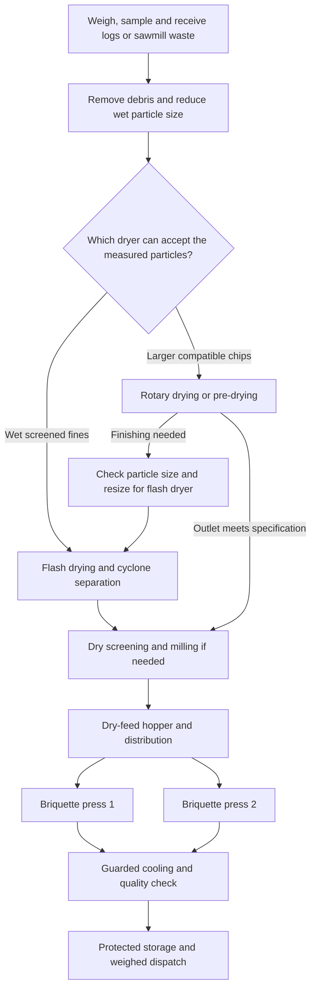

# Factory inspection photo evidence — AKASHYA ENTERPRISES
**Audit: 22 Nov 2026.** The nine photographs were taken at the same reference briquette factory. These are **field observations**, not a manufacturer performance certificate or a measurement survey.

| Reference photo & hardware | Directly visible in photograph | Functional purpose in Akashya 1,000 MT/month plant | Engineering duty check & verification gap |
|---|---|---|---|
| [01: dryer/cyclone/MCC](../FACTORY-PHOTOS/01-drying-tower-cyclone-mcc-panel.jpg) | Tall vertical vessels, duct columns, and industrial electrical control cabinets | Hot furnace gas drying, cyclonic dust separation, and centralized power distribution | Verify water evaporation rating ($\ge 1,563\text{ kg/h}$ at 40%, $\ge 2,492\text{ kg/h}$ at 50%); stack emission clearance; MCC motor starter ratings |
| [02: factory interior & heap](../FACTORY-PHOTOS/02-factory-interior-briquette-heap.jpg) | Covered shed, cylindrical product heap and two apparent reddish press structures | Proposed Akashya design uses two parallel mechanical presses | Count active machines and record actual per-press saleable kg/h. Proposed 1.471 TPH per press is target arithmetic. |
| [03: EcoStan chipper](../FACTORY-PHOTOS/03-ecostan-wood-chipper-close.jpg) | Yellow EcoStan-branded machine with yellow-and-black feeding conveyor receiving logs | Primary log-to-sawdust size reduction: converts incoming logs/branches into small particles | Nameplate model unverified (ESM150 vs others); require guaranteed $\ge 5.0\text{--}6.0\text{ wet TPH}$ throughput on local hardwood |
| [04: raw wood yard](../FACTORY-PHOTOS/04-raw-wood-logs-yard-chipper.jpg) | Mixed logs and branches stacked near the infeed | Reference for receiving and traceable stock control | Identify species, moisture, lot weight and procurement source. Project intake is 63.2 wet MT/day at 40%, or 75.8 at 50%. |
| [05: mechanical press & flywheel](../FACTORY-PHOTOS/05-mechanical-piston-press-flywheel.jpg) | Heavy press drive, visible flywheel and feed hopper | Reciprocating compaction is consistent with the visible arrangement | Identify OEM, model and drive. Measure loaded stroke count. Use the exact maker’s approved bearing and lubricant limits. Photo alone supplies no instrument readings. |
| [06: sawdust discharge conveyor](../FACTORY-PHOTOS/06-inclined-conveyor-sawdust-discharge.jpg) | Inclined conveyor transporting processed wood particles | Continuous material transfer from primary chipper to dryer and intermediate storage | Verify belt capacity ($\ge 6\text{ TPH}$ wet / $\ge 3.3\text{ TPH}$ dry), magnetic tramp-metal removal, and blockage sensor interlocks |
| [07: tractor loader](../FACTORY-PHOTOS/07-tractor-loader-sawdust-handling.jpg) | Tractor loader moving bulk sawdust piles with visible airborne dust | Inbound wood unloading, stockpile management, and log yard material manipulation | Open loader handling creates combustible-dust explosion hazards; Akashya plant must incorporate enclosed chutes and dust extraction |
| [08: pneumatic flash U-ducts](../FACTORY-PHOTOS/08-pneumatic-flash-dryer-u-tubes.jpg) | Tall U-shaped ducts and connected separation equipment | Visual reference for pneumatic drying or air handling | Confirm flow path, heat source and product takeoff by survey. Project dryer duty requires separate wet-inlet, evaporation and dried-output data. |
| [09: finished briquettes & cooling](../FACTORY-PHOTOS/09-90mm-finished-briquettes-cooling-track.jpg) | Brown cylindrical briquettes on a track, with some visible surface cracking | Cooling and transfer before protected storage | Measure actual diameter, cooled temperature, fines, moisture, ash and GCV. Apply buyer-approved test limits. |

---

## Manufacturing process flow

The proposed Akashya line shares receiving and discharge stages. The middle of the line depends on tested wood size and moisture.

The receiving conveyor and EcoStan-branded machine appear in photo 03, an inclined sawdust transfer appears in 06, and the ducts and cyclones appear in 01 and 08. The precise path and flow rates at the reference site need a walkthrough. For proposed design, screen untreated sawmill waste separately and route it to chipping, the wet dryer feed or dry grading according to measured particle size, moisture and contamination.

## Equipment capacity & purpose specification matrix

| Equipment package | Akashya duty at 340 productive h/month [DERIVED / EST] | Input → output and purpose |
|---|---|---|
| **Log receiving conveyor** | **4.64 wet TPH at 40% / 5.57 at 50%; ≥6 wet TPH** design target | Loader or truck batch → metered wood to chipper. Include deck, guides, guards and tramp-removal provisions. |
| **Wood-to-sawdust machine** | **≥6 wet TPH** actual target with measured local logs. EcoStan ESM150 catalogue **3–5 TPH**. | Logs/branches → sized wet particles. EcoStan ESM150's **2–10 mm** example can contain material too large for an IFD flash dryer. |
| **Dryer and heating system** | **1,563 / 2,492 kg/h water**, **~3.08 TPH dried output** at 40% / 50%. Allow engineering margin and prove both duties. | Screened feed → conditioned material, safely separated from hot gas/dust. Infinite IFD accepts **<8 mm** reference; its RFD **<16 mm**. Other rotary designs have their own limits. |
| **Screening / hammer mill** | Design the dry screen for the **~3.08 TPH** stream plus rework. Mill full stream or screen oversize only as determined by trial. | Dried feed → measured press-size distribution. EcoStan HM example requires **≤15%** feed moisture; EcoStan press example **≤15×8 mm**. |
| **Two briquette presses** | **2.941 saleable TPH** combined arithmetic, **≥1.60 TPH sustained per press** sought at acceptance | Graded dried wood, typically **8–12%** within OEM limits → two hot 90 mm product streams. |
| **Cooling conveyor and finished handling** | Two lines, each sized to carry its offered press output. Install per tested residence and layout. | Hot output → cooled, inspected, saleable product to protected storage. Record fines/rejects separately. |
| **Cyclone, filters and fire protection** | Engineer airflow, pressure losses, temperature, dust characteristics and isolation. | Process gas and local airborne dust → separated solids and controlled exhaust. Prove alarm response and safe shutdown. |
| **Control panels and automation** | Integrated MCC, PLC, starters/drives, metering and interlocks. HT/LT capacity from load/start studies. | Drive signals and electrical supply → controlled motors, safety functions and stage-level logging. |
| **Loader and weighbridge** | Truck/loader selection from batch duty and legal dimensions/weights. **50–60 MT** scale class is provisional. | Load/unload wood, feed the yard, weigh incoming and outgoing lots. |
| **Shed, foundations and utilities** | Final area, foundation blocks, safe stock separation and access depend on site and machine drawings. | Site interfaces for equipment, goods, people and emergency access. |

See the [itemised costed BOM](../PROCUREMENT/COMPLETE-1000MT-TURNKEY-BILL-OF-MATERIALS.md) and [wet/dry mass balance](05-WOOD-MOISTURE-AND-DRYER-SIZING.md).

## Evidence hierarchy
- **Observed:** wood logs, chipper, conveyors, visible dust, ducts/cyclones, heavy press drive and finished cylindrical briquettes.
- **Plausible but unproven:** 90mm product, two operating briquetting lines, pneumatic multi-pass flash drying, EcoStan ESM family.
- **Not observable:** 1,000 MT/month actual output, safe press continuous hours, 220–240 ram strokes/min, 1,200–1,500 kg/cm² pressure, binding temperature, annual maintenance, mineral ash, GCV, legally sourced wood and commercial cost.
- **Do not duplicate hazardous practice:** open dust clouds around mobile loaders can present combustible-dust/explosion risks. Design protected bins/conveyors, extraction and safe electrical separation with a competent specialist.

## Field data missing from reference factory
Obtain photo of press and chipper nameplates; live kW and kWh readings; dryer fuel inlet and gas handling; wet-wood to output mass balance; 16h actual shift register; product caliper; supplier quotes and spares record. Only documented results should enter the financial baseline.

For proposed plant engineering, see [BPM & hours](04-BPM-Operating-Hours-and-Live-Machinery-Pricing.md) and [RFQ register](../PROCUREMENT/2026-11-22-MACHINERY-PRICE-AND-RFQ-REGISTER.md).
