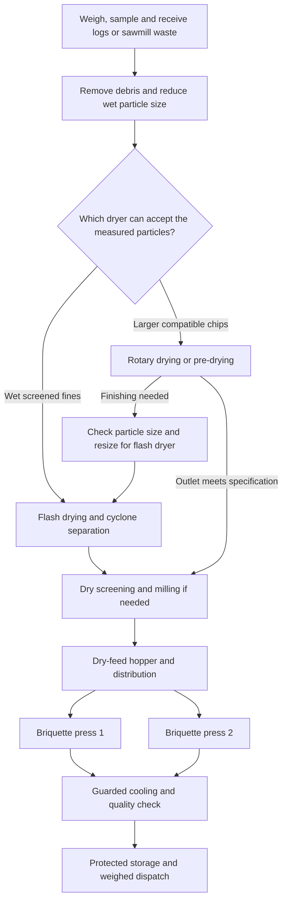

# Factory inspection photo evidence — AKASHYA ENTERPRISES
**Audit: 22 Nov 2026.** The nine photographs were taken at the same reference briquette factory. These are **field observations**, not a manufacturer performance certificate or a measurement survey.

| Reference photo & hardware | Directly visible in photograph | Functional purpose in Akashya 1,000 MT/month plant | Engineering duty check & verification gap |
|---|---|---|---|
| [01: dryer/cyclone/MCC](../FACTORY-PHOTOS/01-drying-tower-cyclone-mcc-panel.jpg) | Tall vertical vessels, duct columns, and industrial electrical control cabinets | Hot furnace gas drying, cyclonic dust separation, and centralized power distribution | Verify water evaporation rating ($\ge 1,563\text{ kg/h}$ at 40%, $\ge 2,492\text{ kg/h}$ at 50%); stack emission clearance; MCC motor starter ratings |
| [02: factory interior & heap](../FACTORY-PHOTOS/02-factory-interior-briquette-heap.jpg) | Covered shed, cylindrical product heap and two apparent reddish press structures | Proposed Akashya design uses two parallel mechanical presses | Count active machines and record actual per-press saleable kg/h. Proposed 1.471 TPH per press is target arithmetic. |
| [03: EcoStan chipper](../FACTORY-PHOTOS/03-ecostan-wood-chipper-close.jpg) | Yellow EcoStan-branded machine with yellow-and-black feeding conveyor receiving logs | Primary log-to-sawdust size reduction: converts incoming logs/branches into small particles | Nameplate model unverified (ESM150 vs others); require guaranteed $\ge 5.0\text{--}6.0\text{ wet TPH}$ throughput on local hardwood |
| [04: raw wood yard](../FACTORY-PHOTOS/04-raw-wood-logs-yard-chipper.jpg) | Mixed logs and branches stacked near the infeed | Reference for receiving and traceable stock control | Identify species, moisture, lot weight and procurement source. Project intake is 63.2 wet MT/day at 40%, or 75.8 at 50%. |
| [05: mechanical press & flywheel](../FACTORY-PHOTOS/05-mechanical-piston-press-flywheel.jpg) | Heavy press drive, visible flywheel and feed hopper | Reciprocating compaction is consistent with the visible arrangement | Identify OEM, model and drive. Measure loaded stroke count. Use the exact maker’s approved bearing and lubricant limits. Photo alone supplies no instrument readings. |
| [06: sawdust discharge conveyor](../FACTORY-PHOTOS/06-inclined-conveyor-sawdust-discharge.jpg) | Inclined conveyor transporting processed wood particles | Continuous material transfer from primary chipper to dryer and intermediate storage | Verify belt capacity ($\ge 6\text{ TPH}$ wet / $\ge 3.3\text{ TPH}$ dry), magnetic tramp-metal removal, and blockage sensor interlocks |
| [07: tractor loader](../FACTORY-PHOTOS/07-tractor-loader-sawdust-handling.jpg) | Tractor loader moving bulk sawdust piles with visible airborne dust | Inbound wood unloading, stockpile management, and log yard material manipulation | Open loader handling creates combustible-dust explosion hazards; Akashya plant must incorporate enclosed chutes and dust extraction |
| [08: pneumatic flash U-ducts](../FACTORY-PHOTOS/08-pneumatic-flash-dryer-u-tubes.jpg) | Tall U-shaped ducts and connected separation equipment | Visual reference for pneumatic drying or air handling | Confirm flow path, heat source and product takeoff by survey. Project dryer duty requires separate wet-inlet, evaporation and dried-output data. |
| [09: finished briquettes & cooling](../FACTORY-PHOTOS/09-90mm-finished-briquettes-cooling-track.jpg) | Brown cylindrical briquettes on a track, with some visible surface cracking | Cooling and transfer before protected storage | Measure actual diameter, cooled temperature, fines, moisture, ash and GCV. Apply buyer-approved test limits. |

---

## Manufacturing process flow

The proposed Akashya line shares receiving and discharge stages. The middle of the line depends on tested wood size and moisture.

The receiving conveyor and EcoStan-branded machine appear in photo 03, an inclined sawdust transfer appears in 06, and the ducts and cyclones appear in 01 and 08. The precise path and flow rates at the reference site need a walkthrough. For proposed design, screen untreated sawmill waste separately and route it to chipping, the wet dryer feed or dry grading according to measured particle size, moisture and contamination.

## Equipment capacity & purpose specification matrix

Read down the rows to follow the proposed plant. Capacities are for **1,000 saleable MT/month and 340 productive h**. Paired values show **40% / 50% wet-basis incoming wood**. Photos identify visible components. The proposed specs, prices and operating windows are planning inputs for Akashya. Package references identify the same costs in the [BOM](../PROCUREMENT/COMPLETE-1000MT-TURNKEY-BILL-OF-MATERIALS.md), including shared scopes.

| Equipment and photo cross-reference | What goes in, what comes out and required duty | Regular check and typical repair scope [EST] | Planning cost and price boundary |
|---|---|---|---|
| **1. Weighbridge, loader and wood intake** (04/07) | Untreated logs, branches and sawmill waste arrive by batch. Record gross/tare, source, moisture and contamination. Route waste by measured chip size and moisture. Intake **63.2 / 75.8 wet MT/day**. **50–60 MT** bridge is a proposed class. Check truck axle/deck geometry and loader payload with attachment. | Loader **10–20 min/day** pre-start, then engine-hour and serial-specific servicing. Daily weighbridge zero check. Repair loader hoses/filters, bucket pins or scale load cells by exact code. | Loader **₹20–32L** and weighbridge **₹7–15L** installed planning bands. Public standalone 60 MT bridge examples **₹4.50–5.00L**. |
| **2. Yellow-and-black log feeding conveyor** (03) | Batch logs → metered feed to cutter. Design toward **≥6 wet TPH** actual on local wood, above **4.64 / 5.57 TPH** average duty. Obtain accepted diameter, length, branch shape, incline, loaded starting torque, reversing/stop controls and anti-bridging provision. | Check tracking/chain, drive load and guides each shift. Budget **10–20 min/day** cleaning and **1–2 h/week** isolated review. Typical faults involve rollers, chain, gearbox, belt/splices or sensors. | **₹6L** owner allocation for deck and metered apron/belt within package 03. Matched log-deck asking price unknown. |
| **3. EcoStan log-to-sawdust or chipper/shredder** (03) | Logs → chips or sawdust. **ESM150 catalogue 3–5 TPH, 159 HP, 2–10 mm**. Max catalogue throughput falls short of **5.57 wet TPH** at 50%. Measure actual sizes. Infinite IFD requires **<8 mm** and RFD **<16 mm**. Add wet-rated screening/rework if needed. | Size/current every **1–2 h**. Budget **10–20 min/shift** and **1–3 h/week**. Review knife wear at **40–80 running h**, change damaged matched knives/anvil through OEM service, and record turnaround. | **₹30–52L** for the primary system including wet-sizing allowance. Exact ESM150 price unknown. The **₹25.55L** EcoStan seller item carries an ESM-75 code. |
| **4. Inclined sawdust transfer conveyors** (06) | Wet chips/fines → metered dryer bin. Separate enclosed dry transfer → screen/hopper. Target **≥6 wet TPH** upstream, about **3.08 dry TPH** fresh downstream, plus measured recirculation. Specify volume, incline, lifts, transfer drop, dust capture, blockage alarms and maintenance access. | Each shift check tracking, carryback, splices and buildup. **10–20 min/day** cleaning and **1–2 h/week** isolated service are shared with package 03. Repair scraper, roller, bearing, splice, screw flights or gearbox per selected design. | **₹6L** for wet/dry transfers, hoppers and sensors within package 03. Public examples include **₹3L** for a 3 m, 5 TPH screw and **₹3.50L** for a separate food-grade inclined belt. Wood duty and installed price require quoting. |
| **5. Furnace, rotary or flash drying and induced-draft fan** (01/08) | **4.64 / 5.57 wet TPH** → **~3.08 TPH** dried material and **1,563 / 2,492 kg/h** evaporated water. Specify particle size, separate water/output guarantees, outlet moisture, fuel specification, drum drive/trunnions where applicable, blower airflow and static pressure. The photo shows ducts and vessels. Confirm dryer technology on site. | Continuous protection and supervision, hourly moisture/fuel/throughput log. Budget a shared **2–4 h/week** thermal service window. Repair scope includes fuel-feed parts, refractory, fan, seals and rotary supports if fitted. Confirm cooldown, cleanout and warm/cold restart time. | **₹65–105L** at 40% or **₹95–145L** preliminary dryer-package allowance at 50%, with installed scope and tested fuel unknown. Infinite IFD3000 **₹42L**, IFD5000 **₹68L**, RFD2000 **₹32L** public equipment examples. |
| **6. Product cyclone, airlock, dust filter and fire equipment** (01/08) | Dust-laden drying air → cyclone separates recoverable solids, airlock discharges solids and the protection/filtration train handles residual dust/gas. Size with actual **m³/h, temperature, dust loading, particle distribution, pressure drop and solids kg/h**. Use engineered protection and isolation per hazard assessment. | Shift trend of discharge/pressure/leakage and baghouse checks, coordinated with dryer service. Typical repairs include worn liners, gaskets, airlock seals/rotor, filters and approved protection components. | **₹6L** process cyclone/airlocks within dryer package 04. **₹20–40L** separate extraction/fire package. Public **~₹2.06L** cyclone example is for a different application. |
| **7. Dry screening, hammer mill and distribution hopper** | **~3.08 fresh TPH** before screen. Mill only the oversize if suitable, or specify full-stream duty plus rework. EcoStan HM100 **2–3 TPH / 133 HP** and HM150 **3–4 TPH / 190 HP**. EcoStan HM feed **≤15% moisture**. Dry hopper distributes graded press feed with agreed moisture and measured bulk density. | Sample feed/gradation **every 1–2 h**. Budget **10–20 min/shift**, **2–4 h/week**. Replace matched hammer/screen/pin sets and service metering screws against wear or imbalance. | **₹14–36L** for dry milling/screening. HM100 example **₹18.05L** and Lehra 50 HP example **₹14.40L**. Shared dry-handling items appear in package 03. |
| **8. Two apparent presses and large flywheel** (02/05) | Proposed: two mechanical 90 mm presses, typically **8–12%** dried feed. Require **1.471 saleable TPH/press** average on productive hours. Seek **1.60 TPH per press** under witnessed trial. Flywheel stores rotational energy and helps carry the press through cyclic loading. Record motor RPM, wheel RPM and loaded ram strokes independently. | Hourly saleable tonnes/fines and **2–4 h** trend review for load, vibration and lubrication. **10–20 min/press/shift** is an inspection allowance. Belt, bearing, hub, shaft or wheel faults go through isolation and OEM alignment/balance assessment. | **₹44–60L** for a pair, including supplied drive components. The exact fitted flywheel or approved overhaul price is unknown. Separate public asks for five manufacturers are linked below. |
| **9. Cooling, product transfer and finished briquettes** (02/09) | Hot 90 mm product → guarded cooling → segregate rejects/fines → weigh and place in protected dry stock. Size for **≥1.60 TPH per press outlet**. Determine track length and time from actual cooled product temperature and discharge trial. | Check temperature, breakage and tracking each shift. Allow **10–20 min/shift** and **1–2 h/week**. Repair worn guides, supports, belts or drives before returning to service. | **₹15–30L**. Owner allocation includes **₹10L** for two cooling/discharge lines. Lehra’s public bundle includes cooling equipment. Standalone matched price unknown. |
| **10. Electrical cabinets and controls** (01) | Specify MCC, starters/drive ratings, PLC/HMI, motor protection, flow/level/temperature alarms, interlocks, panel environment and functional tests. Select transformer after motor starting and kVA study. | Review alarm history and heat/drive alarms each shift. Qualified team handles isolated inspections, drive/contactor replacement, configuration restoration and proof testing. | **₹16–30L** PLC/MCC and line automation. **₹30–60L** for HT/LT connection package. Public **₹8.50L** is transformer equipment only. |

Price evidence was checked **23 November 2026**. Public asks are per item or set as specified. Confirm exact SKU, GST, freight to Anakapalli, installation and validity. Package bands are planning estimates. The full 50% configuration, including furnace fuel use and output, remains unpriced. [Press, dryer and ancillary prices](../PROCUREMENT/2026-11-22-LIVE-MACHINERY-PRICE-EVIDENCE.md) · [Maintenance and repair schedule](03-Breakdown-Risk-Mitigation-and-Maintenance-SOP.md).

## Evidence hierarchy
- **Observed:** wood logs, chipper, conveyors, visible dust, ducts/cyclones, heavy press drive and finished cylindrical briquettes.
- **Plausible but unproven:** 90mm product, two operating briquetting lines, pneumatic multi-pass flash drying, EcoStan ESM family.
- **Not observable:** 1,000 MT/month actual output, safe press continuous hours, 220–240 ram strokes/min, 1,200–1,500 kg/cm² pressure, binding temperature, annual maintenance, mineral ash, GCV, legally sourced wood and commercial cost.
- **Do not duplicate hazardous practice:** open dust clouds around mobile loaders can present combustible-dust/explosion risks. Design protected bins/conveyors, extraction and safe electrical separation with a competent specialist.

## Field data missing from reference factory
Obtain photo of press and chipper nameplates; live kW and kWh readings; dryer fuel inlet and gas handling; wet-wood to output mass balance; 16h actual shift register; product caliper; supplier quotes and spares record. Only documented results should enter the financial baseline.

For proposed plant engineering, see [BPM & hours](04-BPM-Operating-Hours-and-Live-Machinery-Pricing.md) and [RFQ register](../PROCUREMENT/2026-11-22-MACHINERY-PRICE-AND-RFQ-REGISTER.md).
