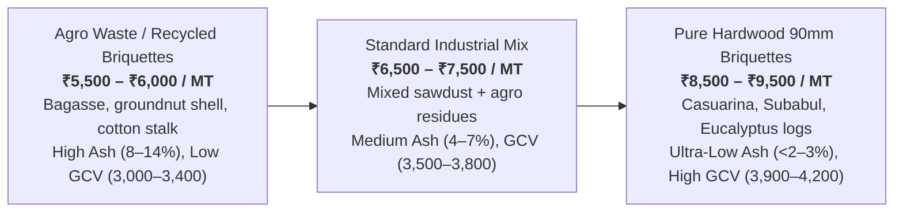

# AKASHYA ENTERPRISES
## Local Competitor Intelligence & Briquette Price Spectrum
**Territory:** Anakapalli, Munagapaka, Sabbavaram, Kasimkota, Pendurthi & Visakhapatnam  
**Reference Date:** November 2026  
**Strategic Focus:** Pure Hardwood Biomass Briquettes (90 mm Cylindrical)  

---

## 🏢 Competitor Register: Nearby Biomass Briquette Manufacturers

| Company Name | Location / Mandal | APPCB / Public Status | Capacity / Details | Key Notes & Contact |
| :--- | :--- | :--- | :--- | :--- |
| **August Briquettes** | MDR65, Venkupalem, Thummapala, Anakapalli | **APPCB Consent Active** (Valid till 31 Dec 2027) | **10 MT / day** (approx. 250–300 MT/month) | Survey No. 346/2. Email: `sudheer.nemani@gmail.com`. Listed asking price: ~₹6,000/MT. |
| **Sri Datta Bio Fuels** | Venkatapuram, Munagapaka Mandal | APPCB Registered (Survey Nos. 310/1 & 310/2) | Small to Medium unit | Prop: Mr. G. K. Naidu (Ph: 90004 98656, GSTIN: 37ADYPL0200C1ZV). Listed at ₹5,500–₹5,800/MT (mostly recycled agro waste). |
| **Monomer Industrial Linings** | Anakapalli Area | Operating Supplier | 90 mm Sawdust Briquettes | Advertised asking price: **₹9,500 / MT** (Validates high-end wood market). |
| **Karthikeya Infra & Earth Resources** | Anakapalli Area | Operating Supplier | 90 mm Briquettes | Advertised asking price: **₹10,000 / MT**. |
| **Greenfy India** | Ugginapalem / Bayyavaram, Kasimkota Mandal | APPCB OCMMS Listed | Operational unit | Sits near NH16 Kasimkota junction; active biomass consent. |
| **Mani Industries** | MSME Industrial Area, Gurrampalem, Pendurthi | APPCB Consent Active | Approved **250 MT / month** | Official MSME cluster manufacturer. |
| **MS LEP Projects** | Anthakapalli, Sabbavaram Mandal | APPCB OCMMS Listed | Biomass briquetting | Close to Sabbavaram junction. |
| **Sri Mohana Siva Shakti Biomass** | Gollalapalem, Sabbavaram Mandal | Directory Verified | Briquette manufacturing | Local rural supplier. |
| **SNS Biofuels** | Gajuwaka / Parawada Industrial Belt | Operating Supplier | Biomass, wood & sawdust briquettes | Proximate to JN Pharma City. |
| **Solid Ply Pvt Ltd** | Dakamarri, Visakhapatnam | Major Wood / Plywood Unit | 100 MT Minimum Order | Wooden briquettes: ₹7,000/MT; Fuel briquettes: ₹8,500/MT; Sawdust: ₹13,000/MT. |
| **North East Company** | PM Palem, Visakhapatnam | Supplier Listing | Sawdust briquettes | Listed at ₹5,800 / MT. |
| **SRK Biochem** | Visakhapatnam | Supplier Listing | 90 mm Sawdust Boiler Briquettes | Listed at **₹7,800 / MT** (in 50 kg bags). |
| **Hanuman Enterprises** | Visakhapatnam | Industrial Supplier | Sawdust briquettes for boilers | Listed at **₹9,500 / MT**. |

---

## 💰 The Price Spectrum: Why Prices Range from ₹5,500 to ₹9,500/MT

A critical insight from market intelligence is understanding why online asking prices vary so dramatically:

### Technical Reasons Your Briquettes Command ₹9,000/MT:

1. **High-Pressure Pharma & Chemical Boiler Requirements:**
   * Modern automated boilers in **Jawaharlal Nehru Pharma City (JNPC), Parawada** and **Atchutapuram SEZ** (e.g., Cohance, Torrent, Laurus) cannot burn cheap agro-waste briquettes without causing severe **slagging, clinker formation, and boiler tube fouling**.
   * Agro-waste (paddy straw, groundnut shells, sugarcane bagasse) contains high alkali metals (silica, potassium, chlorine) with an ash content of **8% to 15%**. This trips boiler dust filters and violates APPCB SPM limits.
2. **Hardwood Log Briquette Advantages (Akashya Enterprises):**
   * **Ash Content:** Less than **2.0% – 3.0%** (minimal boiler tube cleaning required).
   * **Gross Calorific Value (GCV):** **3,800 to 4,200 kcal/kg** (equivalent to 85–90% of B-grade imported coal).
   * **High Compaction Density (1.1–1.2 g/cm³):** The 90 mm mechanical piston press creates dense "white coal" logs that burn steadily in moving grates and fluidized bed boilers without disintegrating into airborne fly-ash.
   * **Coal Parity:** At ₹9,000/MT delivered, the cost per 1,000 kcal of usable steam is competitive with imported Indonesian coal (₹10,500–₹12,000/MT) while providing corporate carbon offset credits under ESG mandates.

---

## 🎯 Tactical Intelligence for Akashya Enterprises

1. **August Briquettes (Thummapala, Anakapalli):**
   * Sits only ~5–8 km from Anakapalli town.
   * Authorized at only **10 MT/day (~250 MT/month)**, operating a single small press line. They do not have the volume to service large 1,000 MT/month corporate boiler supply contracts (e.g., Cohance's 3,600+ tonne requirement).
2. **Sri Datta Bio Fuels (Munagapaka):**
   * Sits in rural Munagapaka (Survey Nos. 310/1 & 310/2). Sells cheaper agro/recycled briquettes at ₹5,500–₹5,800/MT. Their customer base is small local jaggery mills or brick kilns, NOT high-specification pharma boilers.
3. **Monomer Industrial Linings & Hanuman Enterprises:**
   * Both quote **₹9,500/MT for 90 mm sawdust briquettes**, directly confirming that the industrial boiler market around Anakapalli and Vizag routinely pays ₹9,000+ for dense, pure wood products.
