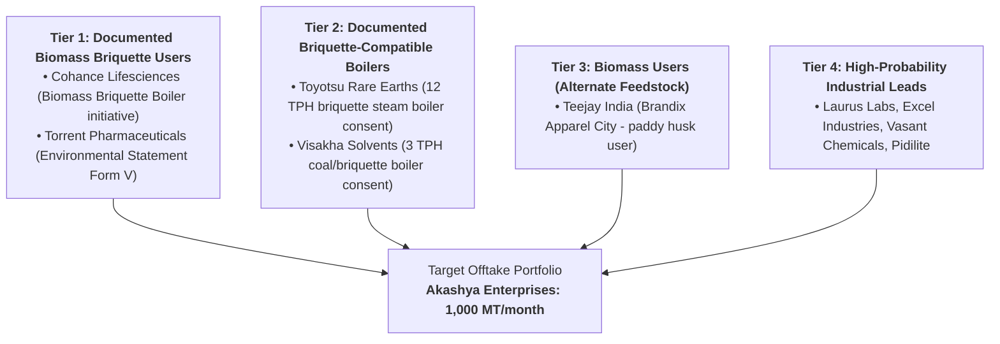
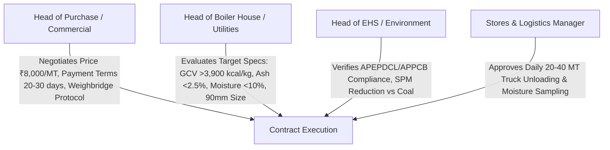

# AKASHYA ENTERPRISES
## Industrial Boiler Buyers in Atchutapuram, Parawada & Lankelapalem
**Target Market:** High-Pressure Steam Boilers & Process Thermal Utilities  
**Corridor Distance:** Within 15–25 km radius of Anakapalli Plant  
**Reference Date:** November 2026  
**Evidence Standard:** Classified by Documented Biomass Use, Boiler Consents, and Potential Prospects  

---

## 🏆 Classification of Regional Boiler Opportunities

To maintain rigorous investment standards, potential industrial buyers within a 25 km radius of Anakapalli are categorized across three distinct verification tiers:

---

### Tier 1: Confirmed Biomass Briquette Users (Primary Offtake Targets)

1. **Cohance Lifesciences Limited**
   * **Location:** Atchutapuram Industrial Area / APSEZ (approx. 18 km from Anakapalli).
   * **Application:** High-pressure steam generation for active pharmaceutical ingredients (API) and chemical synthesis.
   * **Evidence:** FY 2025–26 corporate sustainability disclosure explicitly reports the **"Biomass Briquette Boiler — Atchutapuram"** initiative, offsetting approximately **3,626 metric tonnes of CO₂ equivalent** annually by displacing fossil coal.
   * **Estimated Fuel Need:** ~200 to 450 MT of biomass briquettes monthly (conditional scenario based on steam load).

2. **Torrent Pharmaceuticals Limited**
   * **Location:** Plot No. 77, Jawaharlal Nehru Pharma City (JNPC), Thanam Village, Parawada Mandal (Lankelapalem belt, approx. 22 km from Anakapalli).
   * **Application:** Boiler house utility steam supplied for sterile manufacturing and API crystallization.
   * **Evidence:** Official Environmental Statement explicitly lists **biomass briquettes as designated boiler fuel**.
   * **Estimated Need:** ~100 to 300 MT/month. Pure wood briquettes with ash <2.5% are strictly preferred to maintain GMP cleanroom utility standards.

---

### Tier 2: Documented Briquette-Compatible Boiler Facilities

3. **Toyotsu Rare Earths India Private Limited**
   * **Location:** Plots 2D and 2E, APSEZ, Atchutapuram.
   * **Application:** High-capacity chemical thermal processing and refining.
   * **Evidence:** APPCB operating consent documents an authorized **12-tonne-per-hour (12 TPH) briquette-fired steam boiler**.
   * **Scale & Nuance:** A 12 TPH steam boiler at 75% load consumes between **24 and 42 tonnes of briquettes per day (600–1,050 MT/month)**. *Note: Historical consent approval establishes boiler design capability; current fuel purchasing contracts require fresh verification.*

4. **Visakha Solvents Limited**
   * **Location:** Plot 15B10, Krishnampalem, APSEZ, Rambilli Mandal.
   * **Application:** High-temperature steam for multi-column solvent recovery and distillation.
   * **Evidence:** APPCB consent order authorizes one **3-TPH coal / agricultural-briquette-fired boiler**.
   * **Estimated Potential:** 125–275 MT/month if converted from coal/agro-briquettes to pure hardwood briquettes.

---

### Tier 3: Biomass Boiler User (Alternate Feedstock)

5. **Teejay India Private Limited**
   * **Location:** Plot No. 15, Brandix India Apparel City (BIAC), Pudimadaka Road, Atchutapuram.
   * **Application:** Massive steam generation for industrial fabric dyeing, continuous washing, and finishing.
   * **Evidence:** Sustainability disclosures confirm biomass-powered thermal operations. However, historical reports specifically document **loose paddy husks**, not compressed wood briquettes.
   * **Commercial Conversion Angle:** 90 mm hardwood briquettes offer higher calorific density, lower particulate emissions, and reduced storage footprint compared to loose paddy husk. Potential conversion volume: 375–1,000 MT/month.

---

### Tier 4: High-Probability Industrial Leads (Heavy Thermal Utilities)

| Company Name | Location / SEZ | Core Industry | Primary Boiler Application |
| :--- | :--- | :--- | :--- |
| **Laurus Labs Limited** | Gurajapalem, APSEZ, Atchutapuram | Pharma API & Bulk Drugs | Reactor heating, solvent recovery, steam sterilization |
| **Excel Industries Limited** | Dibbapalem / Krishnampalem, APSEZ | Speciality Chemicals | High-temperature distillation and heating circuits |
| **Vasant Chemicals Pvt. Ltd.** | Western Sector, APSEZ, Atchutapuram | Industrial Chemicals | Reaction vessels and fluid thermal heating |
| **Pidilite Industries Limited** | APSEZ de-notified area | Adhesives & Polymers | Polymerization reactor kettles and drying lines |
| **Ajinomoto Bio-Pharma Services** | Lankelapalem, Parawada SEZ | Bio-Pharmaceuticals | Pharmaceutical clean steam and utility boilers |
| **Viyash Scientific Limited** | Thanam, JN Pharma City, Parawada | Active Pharma Ingredients | Boiler steam (reported active bio-briquette trials) |

---

## 🧮 Boiler Fuel Engineering Math & Addressable Monthly Demand

According to Bureau of Energy Efficiency (BEE) industrial standards, industrial boilers consume approximately **180 kg to 250 kg of biomass briquettes per metric tonne of steam produced** (depending on boiler thermal efficiency, feed-water temperature, and fuel GCV ~4,000 kcal/kg).

### Boiler Formula:
$$\text{Daily Fuel (MT)} = \text{Boiler Capacity (TPH)} \times \text{Running Hours} \times \text{Load Factor} \times 0.220\text{ MT fuel/MT steam}$$

---

### Illustrative Regional Demand Matrix (Conditional Scenarios)

> [!IMPORTANT]
> The figures below represent **illustrative potential scenarios** based on documented boiler capacities and thermal processes. They do not constitute verified purchase orders or guaranteed customer commitments.

| Target Company | Classification Status | Documented Boiler / Process | Illustrative Monthly Demand | Monthly Value (@ ₹8,000/MT Floor) |
| :--- | :--- | :--- | :--- | :--- |
| **Toyotsu Rare Earths** | Tier 2 (Documented Boiler) | 12 TPH Steam Boiler Consent | **600 – 1,050 MT / month** | ₹48.00 L – ₹84.00 Lakh |
| **Cohance Lifesciences** | Tier 1 (Documented User) | Biomass Briquette Boiler | **200 – 450 MT / month** | ₹16.00 L – ₹36.00 Lakh |
| **Teejay India Pvt Ltd** | Tier 3 (Paddy Husk User) | Textile Dyeing Boilers | **375 – 1,000 MT / month** | ₹30.00 L – ₹80.00 Lakh |
| **Torrent Pharmaceuticals**| Tier 1 (Documented User) | API Clean Steam Boilers | **100 – 300 MT / month** | ₹8.00 L – ₹24.00 Lakh |
| **Visakha Solvents** | Tier 2 (Documented Boiler) | 3 TPH Distillation Boiler | **125 – 275 MT / month** | ₹10.00 L – ₹22.00 Lakh |
| **TOTAL SCENARIO RANGE** | **Regional Industrial Radius** | **5 Documented Sites** | **1,400 – 3,075 MT / month** | **₹1.12 Cr – ₹2.46 Crore / month** |

---

## 🧭 Corporate Stakeholder Navigation: How to Close Boiler Fuel Contracts

In corporate factories, fuel purchasing involves four distinct departments. Akashya Enterprises must target all four:

1. **Commercial / Purchase Manager:** Long-term price stability against imported coal volatility; daily 20–40 MT local supply certainty from Anakapalli.
2. **Utilities / Boiler In-Charge:** Fuel performance without grate clinkering or slagging. Offer a **free 5-tonne trial batch** for on-site boiler test-firing.
3. **EHS Department:** APPCB stack emission compliance (SOx elimination, lower particulate matter vs raw coal).
4. **Stores Manager:** Daily electronic gross-tare weighbridge slips and rapid unloading turnaround.

---

## 📄 Target Technical Specifications (Subject to Laboratory Validation)

The following parameters represent **target commercial specifications** for Akashya Enterprises' 90 mm hardwood briquettes, pending formal bomb calorimeter and proximate analysis on actual coastal A.P. timber trial batches:

| Parameter | Target Commercial Specification | Evaluation Status |
| :--- | :--- | :--- |
| **Product Diameter** | 90 mm (± 2 mm) cylindrical logs | Standard EcoStan BPM 90 HD die size |
| **Product Length** | Random lengths (100 mm to 300 mm) | Mechanical extrusion break |
| **Feedstock Material** | 100% Hardwood (*Casuarina, Subabul, Eucalyptus*) | Agro-forestry timber |
| **Moisture Content** | **≤ 8.0% – 10.0%** (wet basis) | Target dryer output |
| **Gross Calorific Value (GCV)** | **Target: ≥ 3,900 to 4,200 kcal/kg** | Subject to bomb calorimeter test |
| **Total Ash Content** | **Target: ≤ 2.0% – 3.0%** (ultra-low ash) | Hardwood benchmark (pending test) |
| **Volatile Matter** | 70% to 75% | Typical biomass range |
| **Fixed Carbon** | 16% to 20% | Calculated |
| **Sulfur Content** | < 0.05% (Virtually Nil) | Non-detectable in clean untreated timber |
| **Bulk Apparent Density** | ≥ 1.15 to 1.25 g/cm³ | High-pressure ram compression target |
| **Delivery Mode** | Bulk loose in 10-wheel/12-wheel tippers | Weighbridge gross-tare basis |
