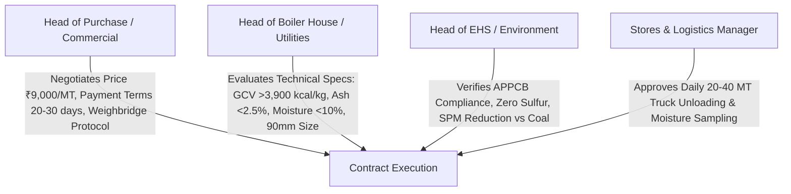

# AKASHYA ENTERPRISES
## Industrial Boiler Buyers in Atchutapuram, Parawada & Lankelapalem
**Target Market:** High-Pressure Steam Boilers & Process Thermal Utilities  
**Corridor Distance:** Within 15–25 km radius of Anakapalli Plant  
**Reference Date:** November 2026  

---

## 🏆 Tier 1: Documented Biomass Briquette Users (Prime Offtake Targets)

These industrial facilities have verified public records or regulatory disclosures proving active biomass briquette boiler operations:

### 1. Cohance Lifesciences Limited
* **Location:** Atchutapuram Industrial Area / APSEZ (approx. 18 km from Anakapalli).
* **Application:** High-pressure steam generation for active pharmaceutical ingredients (API) and chemical synthesis reactors.
* **Documented Proof:** FY 2025–26 corporate sustainability disclosure explicitly reports the **"Biomass Briquette Boiler — Atchutapuram"** initiative, offsetting approximately **3,626 metric tonnes of CO₂ equivalent** annually by displacing fossil coal.
* **Estimated Annual Fuel Need:** ~2,500 to 3,500 MT of biomass briquettes annually (approx. 200–300 MT/month).

---

### 2. Torrent Pharmaceuticals Limited
* **Location:** Plot No. 77, Jawaharlal Nehru Pharma City (JNPC), Thanam Village, Parawada Mandal (Lankelapalem belt, approx. 22 km from Anakapalli).
* **Application:** Boiler house utility steam supplied for sterile manufacturing and API crystallization.
* **Documented Proof:** Official Environmental Statement explicitly lists **biomass briquettes as designated boiler fuel**.
* **Estimated Need:** Consistent, high-specification monthly supply (150–250 MT/month). Pure wood briquettes with ash <2.5% are strictly preferred to maintain GMP cleanroom utility standards.

---

### 3. Toyotsu Rare Earths India Private Limited
* **Location:** Plots 2D and 2E, APSEZ, Atchutapuram.
* **Application:** High-capacity chemical thermal processing and refining.
* **Documented Proof:** APPCB operating consent documents an authorized **12-tonne-per-hour (12 TPH) briquette-fired steam boiler**.
* **Scale:** A 12 TPH steam boiler consumes between **1.5 and 2.0 tonnes of briquettes per hour** of operation (potentially 800–1,200 MT/month at full thermal load).

---

### 4. Visakha Solvents Limited
* **Location:** Plot 15B10, Krishnampalem, APSEZ, Rambilli Mandal.
* **Application:** High-temperature steam for multi-column solvent recovery, fractional distillation, and recycling.
* **Documented Proof:** APPCB consent order authorizes one **3-TPH coal / agricultural-briquette-fired boiler**.
* **Offtake Potential:** 100–180 MT/month. Opportunity to convert them from coal/agro-briquettes to higher GCV hardwood briquettes for higher boiler efficiency.

---

### 5. Teejay India Private Limited
* **Location:** Plot No. 15, Brandix India Apparel City (BIAC), Pudimadaka Road, Atchutapuram.
* **Application:** Massive steam generation for industrial fabric dyeing, continuous washing ranges, and textile stenters.
* **Documented Proof:** Sustainability reports confirm biomass-powered thermal operations (previously utilizing loose paddy husk).
* **Pitch Angle:** Dense 90 mm wood briquettes provide far higher energy density, less smoke/particulate matter, and lower storage footprint than loose paddy husk.

---

## 🏭 Tier 2: Major Industrial Facilities with Heavy Boiler Utility Loads

These major manufacturing plants in the immediate Anakapalli–Atchutapuram–Parawada industrial corridor operate large industrial steam boilers and represent high-probability prospects:

| Company Name | Location / SEZ | Core Industry | Primary Boiler Application |
| :--- | :--- | :--- | :--- |
| **Laurus Labs Limited** | Gurajapalem, APSEZ, Atchutapuram | Pharma API & Bulk Drugs | Reactor heating, solvent recovery, steam sterilization |
| **Excel Industries Limited** | Dibbapalem / Krishnampalem, APSEZ | Speciality Chemicals | High-temperature distillation and heating circuits |
| **Vasant Chemicals Pvt. Ltd.** | Western Sector, APSEZ, Atchutapuram | Industrial Chemicals | Reaction vessels and fluid thermal heating |
| **Pidilite Industries Limited** | APSEZ de-notified area | Adhesives & Polymers | Polymerization reactor kettles and drying lines |
| **Ajinomoto Bio-Pharma Services** | Lankelapalem, Parawada SEZ | Bio-Pharmaceuticals | Pharmaceutical clean steam and utility boilers |
| **Viyash Scientific Limited** | Thanam, JN Pharma City, Parawada | Active Pharma Ingredients | Boiler steam (reported active bio-briquette trials) |

---

## 🧮 Boiler Fuel Engineering Math & Addressable Monthly Demand

According to Bureau of Energy Efficiency (BEE) industrial standards, industrial boilers consume approximately **180 kg to 250 kg of biomass briquettes per metric tonne of steam produced** (depending on boiler thermal efficiency, feed-water temperature, and fuel GCV ~4,000 kcal/kg).

### Boiler Formula:
$$\text{Daily Fuel (MT)} = \text{Boiler Capacity (TPH)} \times \text{Running Hours} \times \text{Load Factor} \times 0.220\text{ MT fuel/MT steam}$$

---

### Company-by-Company Addressable Demand Matrix

| Target Company | Location & SEZ | Documented Boiler / Process | Estimated Daily Demand | **Estimated Monthly Demand** | **Monthly Fuel Budget (@ ₹8,000/MT Floor)** |
| :--- | :--- | :--- | :--- | :--- | :--- |
| **Toyotsu Rare Earths** | Plots 2D & 2E, APSEZ Atchutapuram | Documented 12 TPH Steam Boiler | 24 – 42 MT / day | **600 – 1,050 MT / month** | ₹48.00 Lakh – ₹84.00 Lakh |
| **Cohance Lifesciences** | Atchutapuram Industrial Area | Active Biomass Briquette Boiler | 8 – 18 MT / day | **200 – 450 MT / month** | ₹16.00 Lakh – ₹36.00 Lakh |
| **Teejay India Pvt Ltd** | Plot 15, Brandix Apparel City | Textile Dyeing & Washing Steam | 15 – 40 MT / day | **375 – 1,000 MT / month** | ₹30.00 Lakh – ₹80.00 Lakh |
| **Torrent Pharmaceuticals** | Plot 77, JN Pharma City, Parawada | API Sterile Clean Steam Boilers | 4 – 12 MT / day | **100 – 300 MT / month** | ₹8.00 Lakh – ₹24.00 Lakh |
| **Visakha Solvents** | Plot 15B10, APSEZ Rambilli | Documented 3 TPH Distillation Boiler | 5 – 11 MT / day | **125 – 275 MT / month** | ₹10.00 Lakh – ₹22.00 Lakh |
| **TOTAL REGIONAL DEMAND**| **Within 25 km of Anakapalli** | **Documented Boiler Cluster** | **56 – 123 MT / day** | **1,400 – 3,075 MT / month** | **₹1.12 Crore – ₹2.46 Crore / month** |

> [!NOTE]
> **Market Absorption Takeaway:**  
> Akashya Enterprises' target production of **1,000 MT/month** represents only **32% to 70% of the existing documented boiler fuel consumption** within a 25 km radius. Winning a contract with just **Toyotsu (up to 1,050 MT)** or a combination of **Cohance + Torrent + Visakha Solvents (approx. 700–900 MT)** can absorb 100% of your plant's full capacity!

In corporate factories, fuel purchasing involves four distinct departments. Akashya Enterprises must target all four:

### 1. The Commercial Department (Purchase Manager):
* **Key Concern:** Supply reliability, contract duration (6–12 months), and price stability against volatile coal.
* **The Pitch:** Guaranteed daily delivery of 20–40 MT from an automated local factory in Anakapalli (within 20 km), eliminating interstate rail/road supply chain disruptions.

### 2. The Utilities Department (Boiler In-Charge / Chief Engineer):
* **Key Concern:** Will the fuel cause boiler tube clinkering, grate jamming, or drop steam pressure?
* **The Pitch:** Pure hardwood timber briquettes (90 mm diameter) with **ash content < 2.5%** and **GCV > 3,900–4,200 kcal/kg**. Deliver a free 5-tonne trial truckload for on-site boiler test-firing.

### 3. The EHS Department (Environment, Health & Safety):
* **Key Concern:** APPCB stack emission compliance (Particulate Matter < 50–100 mg/Nm³) and corporate decarbonization (ESG Scope 1 GHG reductions).
* **The Pitch:** Zero sulfur content (eliminates SOx scrubbing costs) and provides verified carbon offset certificates under national renewable thermal mandates.

---

## 📄 Standard Technical Specification Sheet for Sales Contracts

When issuing quotes to Cohance, Torrent, Laurus, or Toyotsu, Akashya Enterprises should offer this guaranteed specification:

| Parameter | Guaranteed Commercial Specification | Test Method |
| :--- | :--- | :--- |
| **Product Diameter** | 90 mm (± 2 mm) cylindrical logs | Physical Caliper |
| **Product Length** | Random lengths (100 mm to 300 mm) | Physical Gauge |
| **Feedstock Material** | 100% Pure Hardwood (*Casuarina, Subabul, Eucalyptus*) | Laboratory Inspection |
| **Moisture Content** | **≤ 8.0% – 10.0%** (wet basis) | Halogen Moisture Analyzer |
| **Gross Calorific Value (GCV)** | **≥ 3,900 to 4,200 kcal/kg** | Bomb Calorimeter (ASTM D5865) |
| **Total Ash Content** | **≤ 2.0% – 3.0%** (ultra-low ash) | Muffle Furnace @ 750°C (ASTM D3174) |
| **Volatile Matter** | 70% to 75% | Proximate Analysis |
| **Fixed Carbon** | 16% to 20% | Differential Calculation |
| **Sulfur Content** | < 0.05% (Virtually Nil) | Ultimate Analysis |
| **Bulk Apparent Density** | ≥ 1.15 to 1.25 g/cm³ | Water Displacement Method |
| **Delivery Mode** | Bulk loose in 10-wheel/12-wheel tippers (or 50 kg HDPE bags upon request) | Electronic Weighbridge Gross-Tare |
