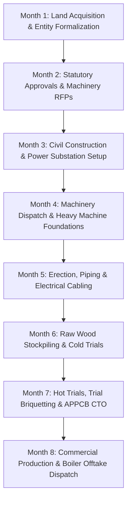

# AKASHYA ENTERPRISES
## Master Project Roadmap & Execution Timeline
**Project:** 1,000 MT/Month Wood Biomass Briquette Plant  
**Location:** Anakapalli District, Andhra Pradesh  
**Target Commissioning:** 2027  

---

## 🗺️ Execution Milestones (Month 1 to Month 8)

---

## 🏛️ Statutory Clearances & Approvals Checklist

| Approval / Clearance | Issuing Authority | Scope & Mandatory Pre-Requisites |
| :--- | :--- | :--- |
| **District Industries Facilitation** | **District Industries Centre (DIC), Anakapalli** | **Primary Nodal Contact:** General Manager, DIC Anakapalli. • **Email:** `dicanakapalli@gmail.com` • **Phone:** `98484 89948` • Official portal: Single Desk Portal (`apindustries.gov.in`). |
| **Wood Industry Determination** | **A.P. Forest Department (Divisional Forest Office)** | Ensure written verification of sourcing from exempted agro-forestry timber (*Casuarina / Sarugudu*, *Eucalyptus*, *Subabul*) under the *A.P. Wood Based Industries Rules, 2018*. Prevents wood transit harassment. |
| **Consent to Establish (CTE)** | **Andhra Pradesh Pollution Control Board (APPCB)** | Online application via `apocmms.nic.in`. **Regulatory Precedent:** APPCB issued CTE to *Sun Bio Mass Pvt Ltd* (Godavari region) under the **Orange Category**, mandating engineered cyclone separators, baghouse filters, stack height >30m, and Forest Dept wood source documentation. |
| **HT Power Feasibility & Connection** | **APEPDCL (Eastern / Central Power Distribution)** | 11 kV HT connection request for 500 kVA contract maximum demand (CMD); approval of 630 kVA transformer, DP yard, and HT metering cubicle under Tariff HT III(A). |
| **Factory Plan Approval & License** | **Directorate of Factories, Andhra Pradesh** | Industrial shed architectural layout, ventilation, fire exits, worker sanitary facilities, and machine guard designs under the Factories Act, 1948. |
| **Fire Safety NOC** | **A.P. State Disaster Response & Fire Services** | Static water reservoir (≥50,000 liters), dedicated diesel hydrant pump, internal/external fire hose reels, and CO2/Dry Chemical Powder extinguishers. |
| **Ground Water Extraction** | **A.P. Ground Water Dept / APWALTA** | Permission for borewell drilling for cooling water, staff sanitation, and firefighting reserves. |
| **GST & Commercial Registrations** | **Commercial Taxes Dept / MSME Udyam** | Udyam Registration (Small Enterprise category (Udyam criteria: Plant & Machinery <₹25 Cr, Turnover <₹100 Cr)), GST registration for industrial biomass fuel (HSN code: 4401 / 4402). |

---

## 💰 Government Subsidies & Policy Incentives

1. **Andhra Pradesh MSME & Entrepreneur Development Policy 4.0 (2024–29):**
   * **Investment Subsidy:** Up to 15%–20% on eligible plant and machinery (subject to policy caps for non-SEZ manufacturing units).
   * **Power Tariff Concession:** Concessional power tariff per unit or fixed rebate for the first 3–5 years of operations.
   * **Stamp Duty & Land Conversion:** 100% reimbursement of stamp duty and transfer duty paid on land purchase/lease.
2. **Central MNRE Biomass Programme (BioURJA):**
   * Previously provided financial assistance of **₹9.00 Lakh per tonne/hour (TPH)** capacity (capped at ₹45 Lakh per project). Phase I concluded on **31 March 2026**; track Phase II guidelines before factoring into debt syndication.
3. **PMEGP Applicability:**
   * Normal PMEGP manufacturing loan ceiling is ₹50 Lakh. Because Akashya Enterprises' project cost is **₹5.20 Cr fixed + ₹0.99 Cr WC**, commercial bank term loans (SBI / Canara / Union Bank / SIDBI) are required.

---

## 📍 Site & Land Sizing Requirements (Excluding Land Purchase Cost)

### Why Private Land Lease Around Anakapalli is the Best Strategy:
* **APIIC Industrial Land Category Benchmarks (FY 2026–27):**
  * *Atchutapuram APSEZ Lease:* ~₹4,042 / m² (**~₹1.64 Crore per acre**).
  * *IDA Parawada Category:* ~₹8,012 / m² (**~₹3.24 Crore per acre**).
* **The Strategic Choice:** Buying 2 acres inside APIIC parks would lock up **₹3.3 to ₹6.5 Crore in land alone**! Leasing 1.5–2.0 acres of private industrial/convertible land along the Anakapalli–Atchutapuram road corridor at ₹25,000–₹40,000/month keeps capital focused on heavy machinery and working capital.

* **Total Plot Area Required:** **1.5 to 2.5 Acres** (approx. 65,000 to 108,000 sq ft).
* **Location Criteria:**
  * Proximity to National Highway 16 (Chennai–Kolkata highway) or Anakapalli–Atchutapuram arterial road.
  * Easy turning radius for 10-wheel and multi-axle 25 MT timber trucks.
  * Direct 11 kV HT transmission line access along the road frontage.
* **Zoning & Layout Breakdown:**
  * **Main Covered Production Shed:** 12,000 to 15,000 sq ft (Pre-Engineered Building with 8m eaves height, concrete floor, skylights).
  * **Outdoor Raw Wood Yard:** 25,000 to 35,000 sq ft for log unloading, debarking, and tractor maneuvering.
  * **Covered Finished Goods Warehouse:** 4,000 sq ft (capable of holding 150–200 MT bagged and bulk briquettes).
  * **Weighbridge & Truck In/Out Bay:** 5,000 sq ft (50–60 MT, 12m × 3m pitless deck).
  * **HT Transformer Yard & Switchgear Room:** 1,500 sq ft fenced compound.
  * **Administrative Office, QC Lab & Workshop:** 1,500 sq ft.
  * **Perimeter Fire Road:** 6m wide concrete/gravel road encircling the entire facility.

---

## 🏭 Next Steps for Akashya Enterprises Promoters

1. **Issue Turnkey RFP to Machinery Manufacturers:**
   * Solicit comparative binding proposals from **EcoStan Machineries** (Punjab) and **Infinite Dryer** on guaranteed continuous throughput using coastal A.P. Casuarina/Subabul timber.
2. **Apply for APPCB CTE & APEPDCL HT Connection:**
   * Finalize the single-line diagram (SLD) and factory layout to initiate statutory approvals without delay.
3. **Execute Offtake MOUs with Industrial Boiler Clients:**
   * Initiate supply discussions with boiler operating companies in **Jawaharlal Nehru Pharma City (JNPC), Parawada** and **Atchutapuram SEZ** to lock in first-year offtake commitments at the ₹8,000/MT baseline floor rate.
